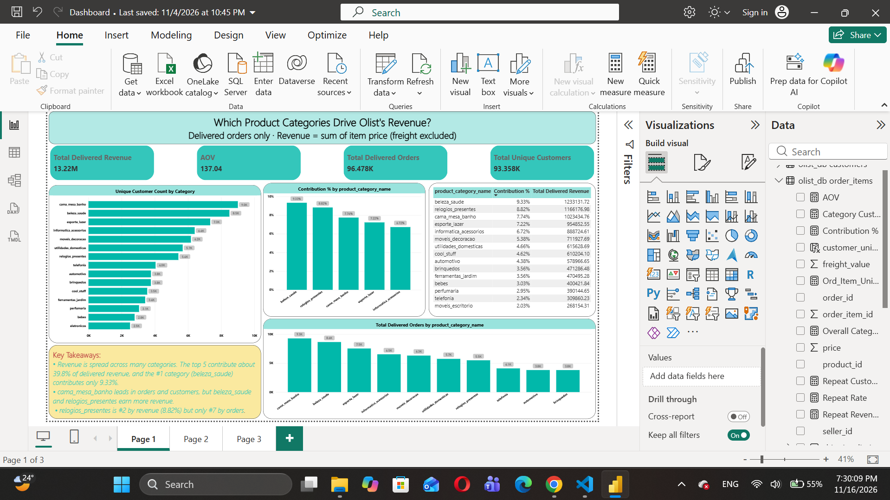
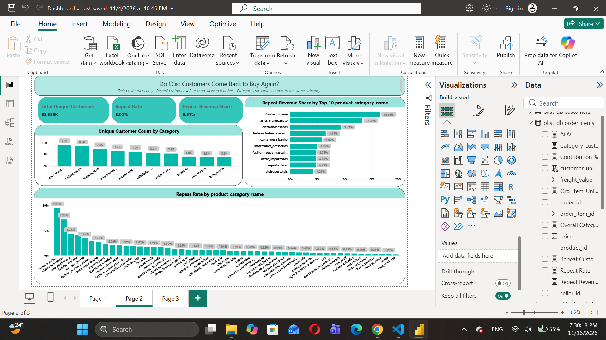
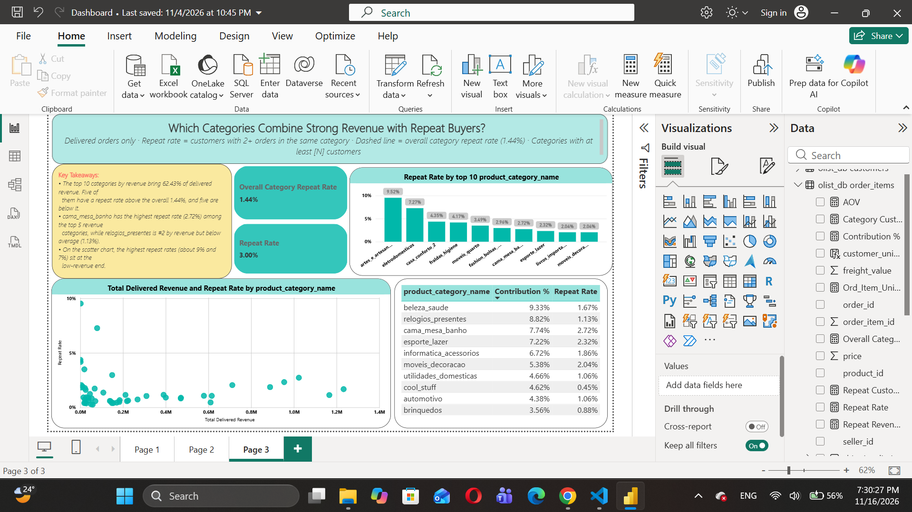

# Olist Category Analysis: Which Product Categories Drive the Business?

An end-to-end data analytics project: **Python (cleaning) → MySQL (analysis) → Power BI (dashboard)**.

**Business problem:** A category manager at Olist (a Brazilian online marketplace) needs to decide which product categories to promote and invest in, and which ones to reduce, based on each category's contribution.
*(The stakeholder is assumed. This is a self-initiated portfolio project, not client work.)*

---

## Dashboard Preview

**Page 1: Which Product Categories Drive Olist's Revenue?**
Revenue, orders and customers by category.



**Page 2: Do Olist Customers Come Back to Buy Again?**
Overall repeat rate, repeat customers' revenue share, and repeat rate by category.



**Page 3: Which Categories Combine Strong Revenue with Repeat Buyers?**
Revenue and repeat rate side by side, compared with the overall category repeat rate.



---

## Key Findings (numbers)

| # | Finding | Number |
|---|---|---|
| 1 | Total delivered revenue (sum of item price) | 13,221,498.11 |
| 2 | Delivered orders / unique customers | 96,478 / 93,358 |
| 3 | Average order value | 137.04 |
| 4 | Revenue is spread out: top 5 categories share of revenue | about 39.8% |
| 5 | The #1 category by revenue is `beleza_saude` | 9.33% of revenue |
| 6 | Customers who ordered again (2+ delivered orders) | 2,801 (3.0%) |
| 7 | Revenue from those repeat customers | 728,408.75 (5.51%) |
| 8 | Overall category repeat rate (same-category repeats) | 1.44% |
| 9 | `cama_mesa_banho` has the highest repeat rate among the top 5 revenue categories | 2.72% |
| 10 | `relogios_presentes` is #2 by revenue but below the overall category average | 8.82% revenue, 1.13% repeat rate |

### What the data shows vs what it does not prove

| What the data shows | What it does not prove |
|---|---|
| Revenue is spread across many categories. No single category contributes more than 9.33%. | That the smaller categories are unimportant. Outside the top 5, categories together bring about 60% of revenue. |
| Only 3.0% of customers placed a second delivered order. They bring 5.51% of revenue, which is about 1.8 times their customer share. | Why customers do not return. The data does not show whether the cause is product, price, delivery or the marketplace itself. |
| `relogios_presentes` earns more revenue than `cama_mesa_banho` with about half the items sold (5,859 vs 10,953) because its average price per item is about twice as high (about 199 vs about 93). | Why its price per item is higher. It could be the type of products sold, but this was not tested. |
| Five of the top 10 revenue categories have a repeat rate above the overall 1.44%, and five are below it. | That a higher repeat rate makes a category better. Small categories can show a high rate from only a few repeat customers. |

---

## Dataset

Olist Brazilian E-Commerce dataset (9 CSV files). Five tables were used, because they are enough to answer the business questions:

| Table | Used for |
|---|---|
| `orders` | Order status and order-to-customer link |
| `customers` | Customer identity (`customer_unique_id`) |
| `order_items` | Item price and product link |
| `products` | Product category |
| `product_category_name_translation` | Portuguese to English category names |

Not used: geolocation, payments, reviews, sellers (not needed for the current questions).

---

## Project Structure

```
├── Business_Problem/
│   └── business_problem.md        # Problem statement and questions
├── Dataset/
│   ├── raw/                       # Original CSV files
│   └── cleaned/                   # Cleaned CSV files
├── Data_Cleaning/
│   └── cleaning.ipynb             # Python cleaning notebook
├── SQL/
│   ├── schema_design.sql          # Database and table creation
│   └── sql_analysis.sql           # Business queries
├── Dashboard/
│   ├── Dashboard.pbix             # Power BI report (3 pages)
│   └── screenshots/               # Dashboard page images used in this README
└── README.md
```

---

## Business Questions

1. Which categories contribute the most revenue?
2. How many unique customers does each category attract?
3. What share of customers come back to buy again (repeat purchase rate)?
4. How does each category compare with the other categories and with the overall average?

| Question | Answered in |
|---|---|
| Q1, Q2 | SQL Q1 · Dashboard Page 1 |
| Q3 | SQL Q3 · Dashboard Page 2 |
| Q4 | SQL Q4 · Dashboard Page 3 |

---

## Workflow

1. **Define** the business problem, questions and metrics before opening the data.
2. **Clean** each table in Python (types, missing values, duplicates, labels).
3. **Load** the cleaned CSV files into MySQL and validate row counts and joins.
4. **Analyse** with SQL (joins, CTEs, window functions, `CASE` aggregation).
5. **Visualise** in Power BI and check every dashboard number against the SQL output.

---

## Data Cleaning (Python)

Notebook: `Data_Cleaning/cleaning.ipynb`

| Table | Finding | Action |
|---|---|---|
| `orders` | 5 date columns stored as text | Converted to `datetime` |
| `orders` | No duplicates on `order_id` (99,441 orders). `order_status` has 8 clean values. | No action |
| `orders` | Missing dates: `order_approved_at` 160, `order_delivered_carrier_date` 1,783, `order_delivered_customer_date` 2,965. Most belong to orders not yet shipped or delivered. A few `delivered` orders also have a missing date (2 and 8 rows). | Kept. These columns are not used in the analysis, and deleting real orders would reduce revenue and customer counts. The cause of the missing dates on delivered orders cannot be confirmed from the data. |
| `customers` | No missing values or duplicates. 27 consistent state codes. | No action |
| `order_items` | `shipping_limit_date` stored as text. No missing values or duplicates. | Converted to `datetime` |
| `products` | `product_category_name` missing in 610 products. The name, description and photo columns are missing in the same 610 rows. | Category set to "Unknown". Products were kept because their orders carry real revenue. "Unknown" is a placeholder, not a real category. |
| `products` | Weight and dimensions missing in the same 2 rows. | Kept. Not used in this analysis. |
| `product_category_name_translation` | 71 rows, 2 columns, no missing values or duplicates. | No action |

---

## Data Validation (after loading into MySQL)

| Check | Result |
|---|---|
| Row counts of all 5 tables vs CSV files | All matched |
| `order_items` JOIN `products` on `product_id` | 112,650 rows, same as `order_items`: no rows lost, none duplicated |
| `products` LEFT JOIN translation table on `product_category_name` | 32,951 rows, same as `products`: no rows lost, none duplicated |
| Products without an English category name | 623 = 610 "Unknown" + 13 products in 2 categories missing from the 71-row translation table (`portateis_cozinha_e_preparadores_de_alimentos`: 10, `pc_gamer`: 3) |

---

## Metric Definitions

- **Revenue rule:** only orders with status `delivered` are counted. Canceled and unavailable orders are excluded because no revenue was earned. Orders still in progress (shipped, invoiced, approved) are also excluded, so revenue is slightly understated.
- **Revenue:** sum of `price` of delivered order items. Freight is excluded because it is a delivery cost driven by weight and distance, not by category demand. This is sales value, not Olist's own revenue (its commission is not in this dataset).
- **Orders:** `COUNT(DISTINCT order_id)`.
- **Customers:** `COUNT(DISTINCT customer_unique_id)`.
- **Repeat customer (Q3):** a customer with 2 or more delivered orders anywhere in the business.
- **Category repeat customer (Q4):** a customer with 2 or more delivered orders in the same category.
- **Counting across categories:** an order or customer that appears in more than one category is counted in each of them, so category numbers should not be added together.

### Pitfalls found and fixed (these changed the numbers)

| Pitfall | Wrong version | Correct version |
|---|---|---|
| Revenue column | Summing `freight_value` made `cama_mesa_banho` the #1 category (201,774 total). | Summing `price` makes `beleza_saude` #1 (1,233,131.72). |
| Counting orders | `COUNT(order_id)` counted order items: 10,953 for `cama_mesa_banho`. | `COUNT(DISTINCT order_id)` gives 9,272 orders. |
| Counting customers | `customer_id` is created per order, so the same person is counted again: 9,272. | `customer_unique_id` identifies the person: 9,008 customers. |
| Rate denominator | Dividing repeat customers by orders understated the repeat rate (2.90%). | Dividing by customers gives 3.0%. |

---

## SQL Analysis (MySQL)

Files: `SQL/schema_design.sql` and `SQL/sql_analysis.sql`
Techniques: multi-table joins, CTEs, window functions (`SUM() OVER()`), `CASE WHEN` aggregation, `HAVING`, `COUNT(DISTINCT ...)`.

### Q1: Which categories contribute the most? (top 5 by revenue)

| Category | Revenue | Revenue % | Delivered orders | Unique customers |
|---|---|---|---|---|
| beleza_saude | 1,233,131.72 | 9.33 | 8,647 | 8,498 |
| relogios_presentes | 1,166,176.98 | 8.82 | not in top 5 | not in top 5 |
| cama_mesa_banho | 1,023,434.76 | 7.74 | 9,272 | 9,008 |
| esporte_lazer | 954,852.55 | 7.22 | 7,530 | 7,341 |
| informatica_acessorios | 888,724.61 | 6.72 | 6,530 | 6,405 |

Overall delivered revenue: 13,221,498.11. The top 5 by orders and by customers are `cama_mesa_banho`, `beleza_saude`, `esporte_lazer`, `informatica_acessorios` and `moveis_decoracao`.

### Q3: What share of customers come back to buy again?

| Metric | Value |
|---|---|
| Customers with at least 1 delivered order | 93,358 |
| Repeat customers (2 or more delivered orders) | 2,801 |
| **Repeat purchase rate** | **3.0%** |
| Total delivered revenue | 13,221,498.11 |
| Revenue from repeat customers | 728,408.75 |
| **Revenue share of repeat customers** | **5.51%** |

### Q4: How does each category compare with the overall average? (top 5 by revenue)

| Category | Customers | Repeat customers | Repeat rate | vs overall (1.44%) |
|---|---|---|---|---|
| beleza_saude | 8,498 | 142 | 1.67% | Above |
| relogios_presentes | 5,421 | 61 | 1.13% | Below |
| cama_mesa_banho | 9,008 | 245 | 2.72% | Above |
| esporte_lazer | 7,341 | 170 | 2.32% | Above |
| informatica_acessorios | 6,405 | 119 | 1.86% | Above |

**Why 1.44% and not 3.0%:** the overall category rate is the pooled ratio of repeat customers to customers across all categories (a customer who buys in two categories is counted in both). Q3's 3.0% counts repeat orders anywhere in the business, so the two rates are not comparable. Category rates should be compared with 1.44%.

---

## Power BI Dashboard

File: `Dashboard/Dashboard.pbix` (data loaded directly from MySQL, relationships set in the data model).

### Page 1: Which Product Categories Drive Olist's Revenue?
- KPI cards: total delivered revenue (13.22M), average order value (137.04), delivered orders (96.478K), unique customers (93.358K).
- Charts: revenue contribution % (top 5), delivered orders (top 10), unique customers (top 15), and a revenue and contribution table.
- A Key Takeaways box states the main findings on the page.

### Page 2: Do Olist Customers Come Back to Buy Again?
- KPI cards: unique customers (93.358K), repeat rate (3.00%), repeat revenue share (5.51%).
- Charts: unique customers by category, repeat revenue share by category (top 10), repeat rate by category.

### Page 3: Which Categories Combine Strong Revenue with Repeat Buyers?
- KPI cards: overall category repeat rate (1.44%) and repeat rate (3.00%).
- Scatter chart: revenue (x-axis) against repeat rate (y-axis) for each category.
- Table: revenue contribution and repeat rate for the top 10 categories by revenue.
- Bar chart: repeat rate for the top 10 categories.
- Key takeaways: the top 10 categories bring 62.43% of delivered revenue; five of them are above the overall 1.44% repeat rate and five are below.

### Technical notes
- **Filter direction:** category filters reach `order_items` but not `orders` or `customers` (filters flow from the "one" side to the "many" side). To count unique customers by category, a calculated column `customer_unique_id` was added to `order_items` with `RELATED`, and the measures use `DISTINCTCOUNT` on it with a `delivered` filter.
- **Repeat measures:** the repeat customer count and the repeat revenue share use `FILTER` over customers with more than one delivered order. The delivered filter has to be applied outside `FILTER`, otherwise canceled orders can make a customer look like a repeat customer (this gave 5.64% before the fix, instead of 5.51%).
- **Category repeat rate:** the denominator must be the customers of that category, not all customers. A wrong denominator showed a maximum of 0.26% on the first version of the chart.
- **Validation:** all dashboard numbers were checked against the SQL output (total revenue, `beleza_saude` 9.33%, `cama_mesa_banho` 9,272 orders and 9,008 customers, total customers 93,358, repeat rate 3.00%, repeat revenue share 5.51%, overall category repeat rate 1.44%).

---

## Limitations

- **Delivered orders only.** Orders still in progress are excluded, so revenue is slightly understated.
- **Revenue is sales value, not Olist's own income.** Commission is not in the data.
- **Repeat behaviour is limited to the dataset's time period.** A customer whose second order falls outside it counts as a one-time buyer.
- **Category repeat rate counts same-category repeats only.** A customer who buys once in each of two categories is not a repeat customer in either.
- **No minimum-customers rule was applied.** Small categories can show a very high repeat rate from only a few repeat customers (the tallest bars on Pages 2 and 3 are an example), so these rates should be read with the customer count in mind.
- **Charts show top categories only** (Top 5, 10 or 15), so the remaining categories are not visible.
- **"Why" is not tested.** The data does not explain why repeat buying is low or why price per item differs between categories.
- **Unknown category.** 610 products have no category and 13 products have no English translation. Category names in the dashboard are shown as in the source data (Portuguese).

---

## How to Reproduce

1. Put the raw CSV files in `Dataset/raw/` and run `Data_Cleaning/cleaning.ipynb` to create the cleaned files in `Dataset/cleaned/`.
2. In MySQL, run `SQL/schema_design.sql`, then load the cleaned CSV files into the 5 tables and check the row counts.
3. Run `SQL/sql_analysis.sql` to reproduce the queries.
4. Open `Dashboard/Dashboard.pbix` in Power BI Desktop and refresh the MySQL connection.

---

## Tools

Python (Pandas) · MySQL · Power BI (DAX) · GitHub

## Author

**Avneesh** · Aspiring Data Analyst
GitHub: [codebyavneesh](https://github.com/codebyavneesh) · LinkedIn: [linkedin.com/in/codebyavneesh](https://linkedin.com/in/codebyavneesh)
